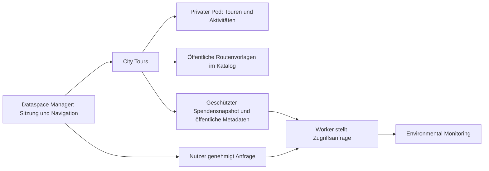

**Solid Dataspace / City Tours – UI- und UX-Analyse**  
Stand: 26.09.2026. City Tours: Version 0.1.14, Checkout `407ac71`.

Der größte Verbesserungsbedarf liegt bei den grundlegenden Bedienabläufen, der mobilen Darstellung und der Sichtbarkeit von Datenfreigaben. Ein visueller Umbau sollte auf diesen Korrekturen aufbauen. Das bestehende Modell aus privaten Touren, abgeschlossenen Aktivitäten, öffentlichen Routenvorlagen und separat freigegebenen Datenspenden bietet dafür eine gute Grundlage.

**Umfang und Aussagekraft**

Geprüft wurden `repos.yaml`, die lokale Orchestrierung, City-Tours-Quellcode und Styles, die Integration im Dataspace Manager sowie die für Tourendaten relevanten Übergänge zu Catalog, Sync Worker und Environmental Monitoring. Die Browserprüfung lief mit Edge/Playwright auf einer isolierten lokalen Vite-Vorschau des unveränderten City-Tours-Quellcodes. Der Arbeitsbereich wurde im unterstützten Gastmodus des Embeds geprüft. Login und Onboarding wurden mit Originalkomponenten dargestellt; das Onboarding verwendete fiktive Profil- und Registry-Daten und einen wirkungslosen Abschluss-Callback.

Die Tests umfassen 320, 390, 768, 1024 und 1440 Pixel Breite, den ersten Importversuch, das Zeichnen und lokale Speichern einer Route, den Abschluss als Aktivität sowie Escape- und Tab-Verhalten. Ein echter Solid-Login, Pod-Schreibzugriffe, Veröffentlichung, Widerruf und der vollständige Manager-Stack wurden nicht ausgeführt. Aussagen dazu beruhen auf Code und Repository-Dokumentation. Die vorhandene Vitest-Suite wurde für diese Analyse nicht erneut ausgeführt. Der einzige protokollierte Ressourcenfehler der anfänglichen lokalen Vorschau war deren fehlendes Favicon.

**Repository-Kontext**

| Teil | Verantwortung | Bedeutung für die Nutzerführung |
| --- | --- | --- |
| `solid-dataspace` | Docker Compose, Caddy, Repository-Zuordnung | Einstiegspfade und gemeinsame Bereitstellung; enthält nicht die eigentliche City-Tours-Oberfläche. |
| `solid-tours` / GitHub `solid-city-tours` | React 18, TypeScript, Vite, Leaflet; Paket `@hoelk-f/city-tours` | Eigenständige App unter `/city-tours/` und integrierte Ansicht unter `/web/city-tours`. |
| `solid-dataspace-manager` | Gemeinsame Navigation, Solid-Sitzung, Sprache, Profil und Zugriffsanfragen | Übergibt Sitzung und Sprache an das Embed; bildet den Rahmen des anwendungsübergreifenden Ablaufs. |
| `semantic-data-catalog` | Öffentliche Routenvorlagen und Metadaten geschützter Datenspenden | Eine auffindbare Datenspende ist noch keine erteilte Leseberechtigung. |
| `solid-data-connection-sync-worker` | Entdeckung von Spenden, Zugriffsanfrage und Zusammenführung zugelassener Beiträge | Die Verarbeitung erfolgt nachgelagert; Fortschritt und Wartezustände sollten sichtbar sein. |
| `environmental-monitoring` | Darstellung des gemeinsamen Tourenfeeds | Hier wird das Ergebnis einer genehmigten Spende sichtbar. |

City Tours zeichnet frei oder importiert GPX/GeoJSON. Neue Routen verwenden ausdrücklich keinen Routingdienst und die App zeichnet kein GPS auf. Ohne passende GPX-Zeitinformationen werden Aktivitätswerte aus Standardgeschwindigkeiten berechnet. Diese Produktgrenzen sollten direkt bei Planung und Aktivitätsanzeige verständlich sein.

Positiv sind die Wiederverwendung der Manager-Sitzung, die getrennten Standalone-/Embed-Hüllen, die Sprachunterstützung, vorhandene Ladezustände und die explizite Auswahl zwischen Gehen und Radfahren beim Abschluss. Der Code enthält außerdem umfangreiche Schutzmechanismen für parallele Änderungen, Veröffentlichungsfehler und Wiederherstellung. Diese Logik sollte bei UI-Arbeiten erhalten bleiben.

**Bestätigte Bedienprobleme – zuerst beheben**

| Priorität | Befund und Auswirkung | Konkrete Korrektur |
| --- | --- | --- |
| P1 | **Mobile Karte verschwindet.** Bei 390 Pixeln bleiben der Karte im isolierten Embed 4 Pixel, bei 320 Pixeln 0 Pixel. Die feste Seitenleiste nimmt den Platz ein. | Unter einem passenden Container-Breakpoint auf Karte mit aufklappbarem Bedienpanel oder einen klaren Wechsel zwischen Karte und Liste umstellen. |
| P1 | **Erster Dateiimport blockiert.** Ein frisch erzeugter, unberührter Entwurf gilt bereits als ungespeicherte Änderung. Die Beispiel-GeoJSON-Datei wird deshalb mit „Speichere oder verwirf zuerst …“ abgewiesen. | Unberührten Anfangszustand von tatsächlich veränderten Entwürfen unterscheiden. Bei echten Änderungen einen Dialog mit Speichern, Verwerfen und Abbrechen anbieten. |
| P1 | **Dialog verhält sich per Tastatur nicht modal.** Nach dem Öffnen bleibt der Fokus auf „Tour gemacht“ hinter dem Dialog. Tab erreicht Kartensteuerung und externe Kartenlinks; später verlässt der Fokus den Dialog erneut. Escape schließt ihn nicht. | Gemeinsame Dialogkomponente mit initialem Fokus, begrenzter Tab-Reihenfolge, Escape, inaktivem Hintergrund und Fokusrückgabe. |
| P1 | **Kartenlegende verdeckt Fehlermeldungsaktion.** Der Schließen-Knopf des Fehlerbanners ist bei Desktopbreite von der Legende überlagert; Playwright meldet abgefangene Pointer-Ereignisse. | Fehler nahe der auslösenden Aktion anzeigen. Karten-Overlays räumlich trennen und eine eindeutige Ebenenreihenfolge verwenden. |
| P1 | **Import fehlt in der Tastaturreihenfolge.** Das Dateifeld hat `display: none`; die sichtbare Beschriftung ist kein fokussierbarer Button. | Einen echten „Datei importieren“-Button oder ein zugängliches Dateifeld verwenden. Den deaktivierten Zustand auch sichtbar darstellen. |

Die Mobilmessung erfolgte ohne die äußere Manager-Navigation und deren globale Skalierung. Sie beschreibt die verfügbare Breite des City-Tours-Embeds, nicht einen vollständig getesteten Manager-Bildschirm. Die isolierte Ansicht reserviert außerdem die im Embed-CSS vorgesehenen 230 Pixel für den Host; der dadurch freie Bereich unter der Karte ist kein zusätzlicher Produktbefund.

| Verfügbare Embed-Breite | Seitenleiste | Karte |
| --- | ---: | ---: |
| 320 px | 294 px | 0 px |
| 390 px | 360 px | 4 px |
| 768 px | 360 px | 382 px |
| 1024 px | 360 px | 638 px |
| 1440 px | 360 px | 1054 px |

Bei 768 Pixeln überlagern sich zudem Legende und Kennzahlen teilweise. Die Anpassung muss daher das Zusammenspiel der Karten-Overlays berücksichtigen.

Belegstellen: [Layout und feste Seitenleiste](C:/Users/hoelk/source/repos/solid-dataspace/solid-tours/src/App.css:159), [Importprüfung](C:/Users/hoelk/source/repos/solid-dataspace/solid-tours/src/App.tsx:1232), [Prüfung ungespeicherter Änderungen](C:/Users/hoelk/source/repos/solid-dataspace/solid-tours/src/App.tsx:2783), [Dateifeld](C:/Users/hoelk/source/repos/solid-dataspace/solid-tours/src/App.css:209), [Dialog](C:/Users/hoelk/source/repos/solid-dataspace/solid-tours/src/App.tsx:3960), [Fehlerbanner](C:/Users/hoelk/source/repos/solid-dataspace/solid-tours/src/App.tsx:3798), [gemeinsame Overlay-Ebene](C:/Users/hoelk/source/repos/solid-dataspace/solid-tours/src/App.css:265).

Für modale Dialoge beschreibt das [W3C-Dialogmuster](https://www.w3.org/WAI/ARIA/apg/patterns/dialog-modal/) den Fokuswechsel, das Halten des Fokus im Dialog und Escape ausdrücklich. Eine Karte darf räumliches Scrollen benötigen; die [W3C-Erläuterung zu Reflow](https://www.w3.org/WAI/WCAG22/Understanding/reflow.html) rechtfertigt damit jedoch keinen Funktionsverlust durch eine auf null schrumpfende Kartenfläche. Dies ist eine gezielte Prüfung und kein vollständiges WCAG-Konformitätsaudit.

**Einstieg und Orientierung**

Die Login-Seite stellt Anbieterwahl und eine große animierte Grafik in den Mittelpunkt. Der unmittelbare Nutzen und die Erklärung des Solid-Kontos fehlen im gerenderten Formular, obwohl passende Übersetzungstexte bereits existieren. Ein möglicher Einstieg wäre: „Plane Touren in Wuppertal. Speichere sie privat und entscheide selbst, was du teilst.“ Darunter „Mit deinem Solid-Konto anmelden“, eine kurze Erklärung und ein aufklappbarer Eintrag „Anderer Pod-Anbieter“ statt „Eigener Issuer“.

Die Standalone-Ersteinrichtung verlangt sieben Bestätigungen sowie öffentliche Profilangaben und eine Registry-Auswahl. Das Embed verlangt vier appbezogene Bestätigungen und bereits vorbereitete Infrastruktur. Begriffe wie „Owner-only“, „Control“, „Research-Modus“ und „Restricted Snapshot“ machen die technische Umsetzung zu einer Voraussetzung für die erste Tour. Die Hinweise zu Sichtbarkeit und Identifizierbarkeit sind relevant; ihr Zeitpunkt und ihre Darstellung sollten verbessert werden.

Empfehlung: zunächst den privaten Tourbereich verständlich einrichten. Öffentliche Identität, Registry und Veröffentlichung erst beim ersten entsprechenden Teilvorgang erklären und bestätigen lassen. Das erfordert eine echte Trennung der bisherigen Initialisierung und Readiness-Prüfungen. Nur die Checkboxen auszublenden wäre keine korrekte Umsetzung.

Belege: [Login-Komponente](C:/Users/hoelk/source/repos/solid-dataspace/solid-tours/src/StandaloneLogin.tsx:109), [Onboarding-Inhalte und Pflichtbedingungen](C:/Users/hoelk/source/repos/solid-dataspace/solid-tours/src/CityToursOnboarding.tsx:112).

**Vorgeschlagene Informationsarchitektur**

| Bereich | Inhalt | Wichtigste Aktion |
| --- | --- | --- |
| Meine Touren | Gespeicherte Routen, Suche, Sortierung und gewählte Tour | Neue Tour |
| Entdecken | Öffentliche Routenvorlagen mit verständlicher Vorschau | Tour übernehmen |
| Aktivitäten | Datum, Fortbewegungsart, Strecke und Herkunft berechneter Werte | Aktivität erfassen |
| Freigaben | Öffentliche Routenvorlagen und Datenspenden mit getrennten Zuständen | Freigabe ansehen oder verwalten |

Der Editor öffnet sich innerhalb von „Meine Touren“. So konkurrieren Planung, Katalog, Verlauf und Freigabe nicht ständig in derselben scrollbaren Spalte. Pro Zustand sollte eine Hauptaktion sichtbar sein: im leeren Zustand „Route zeichnen“ oder „Datei importieren“, im Editor „Tour speichern“, in der Detailansicht „Als absolviert eintragen“.

Desktop: Karte mit einem situationsabhängigen Seitenpanel und kompakter Tourenzusammenfassung. Mobil: Karte über die verfügbare Breite, ein aufklappbares Panel unten und schnell erreichbare Navigation. Das Panel darf die Karte zeitweise überdecken, soll sie jedoch nicht dauerhaft auf eine unbrauchbare Breite zusammendrücken. Der vorhandene `ResizeObserver` für Leaflet kann weiterhin Größenänderungen begleiten.

**Routenplanung und Aktivitäten**

Der erste Kartenpunkt ist derzeit nicht sichtbar, weil nur Linien ab zwei Punkten gezeichnet werden. Nach Geometrieänderungen führt der Effekt erneut `fitBounds` aus. Für kontrolliertes Zeichnen empfehle ich einen sichtbaren Startpunkt, einen Endpunkt und einen kurzen Hinweis „Tippe auf die Karte, um Punkte zu setzen“. Die Karte sollte während des Zeichnens ihren Ausschnitt behalten; „Route anzeigen“ kann den Ausschnitt gezielt anpassen. Eine Ortsuche wäre eine spätere Ergänzung. Ein Routingdienst wäre eine eigenständige Erweiterung des bisherigen Produktumfangs.

„Frei zeichnen“ sieht wie eine Aktion aus, besitzt aber keinen eigenen Klickhandler. Einen klaren Zeichenmodus mit „Zeichnen beenden“ anzeigen oder den Text als Status gestalten. Rückgängig sollte auch das Leeren einer Route auffangen können. Für ungespeicherte Änderungen fehlen im untersuchten Code außerdem Schutzmechanismen beim Verlassen oder Neuladen der Seite.

„Tour gemacht“ steht schon im leeren Zustand bereit und benötigt anschließend eine Fehlermeldung, um die Voraussetzungen zu erklären. Datum und Aktivitätsart gehören gemeinsam in den Abschlussdialog der ausgewählten Tour. „Heute“ und „Gestern“ können häufige Eingaben verkürzen. Ein Datumfehler sollte am Feld erscheinen und nicht ausschließlich auf der Karte.

Die berechneten Werte sind im Dialog bereits teilweise gekennzeichnet: „Berechnet“ und „ca.“ sind vorhanden. In der Übersicht sollte die Herkunft dennoch dauerhaft sichtbar bleiben: „Geschätzte Dauer“, „Geschätzte Schritte“ beziehungsweise „Dauer aus GPX“. Das Datenmodell enthält `durationSource` bereits. Die Annahmen sind 4,5 km/h zu Fuß, 15 km/h mit dem Fahrrad und 0,75 m Schrittlänge. Die nackte Kennzahl „Dauer –“ bei frei gezeichneten Touren sollte erläutert oder durch nachvollziehbare Vorschauwerte ersetzt werden, ohne dadurch vorzeitig einen Aktivitätstyp festzulegen.

Belege: [Karteninteraktion](C:/Users/hoelk/source/repos/solid-dataspace/solid-tours/src/App.tsx:354), [Linien und Ausschnitt](C:/Users/hoelk/source/repos/solid-dataspace/solid-tours/src/App.tsx:413), [Aktionsdarstellung](C:/Users/hoelk/source/repos/solid-dataspace/solid-tours/src/App.tsx:3541), [Datumsfeld und Abschlussaktion](C:/Users/hoelk/source/repos/solid-dataspace/solid-tours/src/App.tsx:3660), [Berechnungsmodell](C:/Users/hoelk/source/repos/solid-dataspace/solid-tours/src/domain.ts:17).

**Freigaben verständlich machen**

Zwei unterschiedliche Vorgänge benötigen unterschiedliche Begriffe und Statusanzeigen:

| Vorgang | Tatsächlicher Effekt | Bessere Darstellung |
| --- | --- | --- |
| Route „indizieren“ | Routenvorlage mit Namen und exakter Geometrie öffentlich zugänglich machen; öffentliche Metadaten umfassen Identitätsangaben. | „Route öffentlich teilen“, vorab die konkrete Route und die veröffentlichten Felder zeigen. |
| Gesundheitsdatenspende freigeben | Snapshot aller aktuell abgeschlossenen Aktivitäten vorbereiten und auffindbar machen. Der Worker benötigt anschließend eine eigene Zugriffsfreigabe. | „Datenspende vorbereiten“, Anzahl und Zeitraum anzeigen; nach der Vorbereitung den nächsten Schritt erklären. |

Der aktuelle Arbeitsbereich unterscheidet bei der Spende hauptsächlich zwischen „Freigeben“ und „Zurücksetzen“. Er zeigt nicht ausreichend, ob eine Anfrage aussteht, der Zugriff genehmigt wurde oder der Beitrag bereits verarbeitet ist. Eine Statusansicht sollte diese Schritte nur dann bestätigen, wenn sie aus den jeweiligen Systemen belegt sind. `activeRun.phase` allein bestätigt keine erfolgreiche Veröffentlichung im Monitoring.

Ebenso wichtig: Ein aktiver Snapshot enthält festgelegte Aktivitäts-IDs. Später erfasste Aktivitäten landen nicht automatisch in ihm. Sinnvoll wäre beispielsweise „3 Aktivitäten in deiner aktuellen Spende · 2 weitere noch nicht enthalten“. Die Aktualisierung müsste den bestehenden Snapshot- und Berechtigungsablauf bewusst ausführen.

Direkte Navigation zur passenden Zugriffsanfrage im Manager würde den Bruch zwischen den Apps verringern. In der eigenständigen City-Tours-App fehlt diese umliegende Manager-Navigation vollständig. Einen klaren Weg zur Anfragenverwaltung anbieten. Der Widerruf sollte seine Wirkung erklären; laut Worker-Dokumentation verschwinden Beiträge nach dem nächsten erfolgreichen Poll, eine bereits geöffnete Monitoring-Seite aktualisiert sich später oder beim Neuladen. Keine sofortige Entfernung aus allen bereits gesehenen Ansichten versprechen.

Belege: [Spendensnapshot](C:/Users/hoelk/source/repos/solid-dataspace/solid-tours/src/App.tsx:1862), [Freigabebuttons](C:/Users/hoelk/source/repos/solid-dataspace/solid-tours/src/App.tsx:3766), [Zugriffsanfragen im Manager](C:/Users/hoelk/source/repos/solid-dataspace/solid-dataspace-manager/src/components/Sidebar.jsx:193), [Feed und Aktualisierung](C:/Users/hoelk/source/repos/solid-dataspace/solid-data-connection-sync-worker/README.md:153).

**Visuelle Gestaltung und Konsistenz im Gesamtprojekt**

Die bestehende Farbwelt aus dunklem Blau und orangefarbener Route passt zum Produkt und kann bleiben. Die Oberfläche gewinnt vor allem durch eine klarere Gewichtung: weniger verschachtelte Karten, weniger gleich starke Schatten, eine kräftige Hauptaktion und ruhigere Nebenaktionen. Eine Tour sollte zuerst über Name, Strecke, Verlauf und Status erkennbar sein; Verwaltungsaktionen können in ein gut erreichbares Menü wandern.

Die globale Skalierung auf 70 Prozent ist ein übergreifendes Problem: sowohl der Manager als auch die Standalone-Ansicht verwenden CSS-`zoom`. Zusammen mit Schriftgrößen unter einem `rem` werden wichtige Inhalte sehr klein. Beispielsweise entsprechen `0.76rem` bei 16 Pixel Basisschrift und Faktor 0,7 rechnerisch etwa 8,5 dargestellten Pixeln. Die Oberfläche sollte über sinnvolle Abstände und responsive Aufteilung passen, statt insgesamt verkleinert zu werden. Safari-Ausnahmen zeigen bereits den zusätzlichen Aufwand dieses Ansatzes.

Für das Projekt empfehle ich gemeinsame semantische Tokens für Schriftgrößen, Abstände, Farben, Radien und Fokuszustände sowie wiederverwendbare Buttons, Formulare und Dialoge. Die bestehende CSS-Isolation der Embeds bleibt dabei wichtig. Ein vollständiger Austausch von Manrope oder der Markenfarben ist nicht nötig. Der Manager sollte außerdem seine fest englischen Navigationsbegriffe an die gewählte Sprache anbinden; das City-Tours-Embed übernimmt die Sprache bereits korrekt.

Touch-Flächen von ungefähr 44 Pixeln sind ein sinnvoller Gestaltungswert für die wichtigsten mobilen Aktionen. Das ist nicht pauschal das WCAG-AA-Minimum: [WCAG 2.2 Target Size (Minimum)](https://www.w3.org/WAI/WCAG22/Understanding/target-size-minimum.html) nennt 24 mal 24 CSS-Pixel mit Ausnahmen beziehungsweise Abstandsbedingungen.

Belege: [City-Tours-Skalierung](C:/Users/hoelk/source/repos/solid-dataspace/solid-tours/src/App.css:103), [Manager-Skalierung](C:/Users/hoelk/source/repos/solid-dataspace/solid-dataspace-manager/src/index.css:1), [Schriften und Aktionen](C:/Users/hoelk/source/repos/solid-dataspace/solid-tours/src/App.css:192), [Manager-Navigation](C:/Users/hoelk/source/repos/solid-dataspace/solid-dataspace-manager/src/components/Sidebar.jsx:181).

**Umsetzung in sinnvoller Reihenfolge**

1. **Bedienbarkeit herstellen:** Import aus unberührtem Anfangszustand, mobile Kartenfläche, überlappende Meldungen und Dialog-/Import-Tastaturbedienung korrigieren. Mit frischem Browserzustand und echten Viewports prüfen.
2. **Tourenablauf ordnen:** kontextabhängige Aktionen, sichtbarer Zeichenmodus, Erstpunkt-Markierung, stabiler Kartenausschnitt, Abschlussdialog mit Datum und Quellenkennzeichnung. Lesbarkeit ohne globale Verkleinerung herstellen.
3. **Freigabeablauf verbinden:** getrennte Sichtbarkeitszustände, Vorschau des Spendensnapshots, nachvollziehbare nächste Schritte und Übergang zu den Manager-Anfragen. Hier sind Schnittstellen zwischen Anwendungen betroffen.
4. **Einstieg vereinfachen und Gestaltung vereinheitlichen:** private Einrichtung von öffentlicher Nutzung trennen, verständliche Texte und gemeinsame UI-Bausteine einführen. Danach Suche, Filter und besseres Entdecken ergänzen.

`App.tsx` umfasst rund 4.060 Zeilen und verbindet Kartenrendering, Authentifizierung, Speicherung, Veröffentlichung, Wiederherstellung und Dialoge. Ein schrittweiser Zuschnitt in `TourMap`, `RouteEditor`, `TourLibrary`, `ActivityHistory`, `SharingPanel` und gemeinsame Dialoge würde diese Arbeit erleichtern. Erst Präsentation und Zustandsdarstellung herauslösen; die bestehenden Schutzmechanismen für Pod- und Publikationsoperationen nicht nebenbei neu schreiben.

Autospeichern ist nur für private Entwürfe eine naheliegende Ergänzung. Bei bereits veröffentlichten Routen aktualisiert der jetzige Speichervorgang auch den öffentlichen Katalogeintrag. Eine automatische private Speicherung darf diesen öffentlichen Effekt nicht unbemerkt übernehmen. Zudem ist der Verzicht auf eine zusätzliche Erfolgsmeldung nach Aktivitätsabschluss ausdrücklich getestet; eine neue dauerhafte Speicherstatusanzeige wäre eine bewusste Produktänderung.

**Prüfbare Abnahmekriterien**

- Eine neue Person kann direkt eine Beispieldatei importieren, ohne vorher eine künstliche Route anlegen zu müssen.
- Bei 320 und 390 Pixeln bleiben Karte, Routenwahl und Hauptaktion erreichbar; bei 768 Pixeln überlappen sich keine Kartensteuerungen.
- Mit der Tastatur sind Import und alle Dialogaktionen erreichbar; Tab bleibt im geöffneten Dialog, Escape schließt ihn und der Fokus kehrt zurück.
- Ein erster Kartenpunkt ist sichtbar, der Kartenausschnitt bleibt beim Weiterzeichnen stabil und versehentliches Leeren ist rückgängig machbar.
- Jede Aktivitätsübersicht unterscheidet berechnete und importierte Zeitwerte verständlich.
- Vor dem Teilen sind Route beziehungsweise Snapshot, enthaltene Daten, Empfänger und öffentliche Sichtbarkeit erkennbar.
- Nutzer sehen nach dem Vorbereiten einer Spende den nächsten notwendigen Schritt und erkennen später hinzugekommene, noch nicht enthaltene Aktivitäten.
- Standalone und Embed werden separat geprüft; der Integrationscheck umfasst Host-Skalierung, Navigation und reale Pod-Zugriffe.

**Aufnahmen und Reproduktion**

- [Desktop mit gespeicherter lokaler Testtour](desktop-current.png)
- [Mobile Ansicht bei 390 Pixeln](mobile-390.png)
- [Tabletansicht bei 768 Pixeln](tablet-768.png)
- [Überlagerte Importfehlermeldung und unsichtbarer erster Punkt](first-point.png)
- [Abschlussdialog](completion-dialog.png)
- [Login](login-desktop.png)
- [Onboarding mit fiktiven Daten](onboarding-desktop.png)

Die lokale Prüfhülle liegt neben diesem Bericht. `node output/playwright/city-tours-review/server.mjs` startet sie unter `http://127.0.0.1:4306/`; `?screen=login&lang=de` zeigt den Login und `?screen=onboarding` die Einrichtung mit fiktiven Daten. Sie verwendet die bereits installierten Abhängigkeiten im Schwester-Repository. `measure.cjs` und `focus.cjs` dokumentieren die über Playwright CLI ausgeführten Layout- und Fokusmessungen. Anwendungsquellcode wurde nicht verändert und es wurden keine Commits erstellt.
